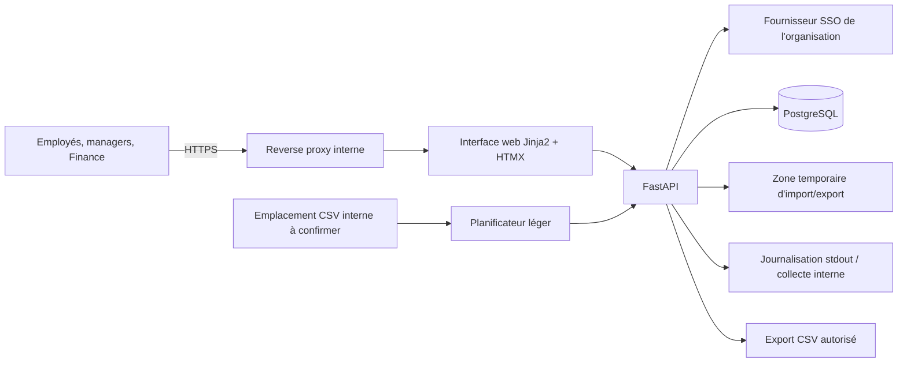

# Architecture — Timesheet Pipeline

**Statut : proposition à valider — aucune implémentation autorisée.**

## 1. Contraintes et faits

- Le dépôt contient un service FastAPI et un ETL pandas qui lit un CSV local.
- Les données actuelles comprennent dates, collaborateurs, projets, heures et
  taux horaires; le pipeline calcule des coûts et des agrégations.
- L'application web, le SSO, la saisie manuelle, les corrections, les imports
  CSV/batch/planifiés et les exports CSV sont demandés.
- Le fournisseur SSO, la signification d'hébergement « local », la volumétrie
  et les règles financières ne sont pas confirmés.

## 2. Architecture proposée

### Vue d'ensemble



Le schéma représente une cible recommandée, pas l'état actuel. L'importeur
planifié peut être un processus séparé dans la même image/conteneur, ou une
commande dédiée exécutée par le planificateur déjà disponible dans
l'environnement. Ne pas ajouter de broker de messages avant que la volumétrie
ou les besoins de reprise le justifient.

### Responsabilités des composants

- **Interface web :** formulaires de saisie/correction, prévisualisation des
  imports, rapports, affichage des erreurs et liens d'export.
- **FastAPI :** authentification via OIDC, autorisation, validation de contrats,
  orchestration d'import/export, calcul métier et API versionnée.
- **PostgreSQL :** source de vérité pour les saisies, projets, imports et
  historique requis.
- **Planificateur :** déclenchement d'import selon un calendrier approuvé;
  journalisation d'un identifiant d'exécution et de son résultat.
- **Stockage temporaire :** traitement de fichiers entrants/sortants avec
  durée de vie limitée; ne pas exposer les fichiers directement par URL
  publique.
- **Reverse proxy :** terminaison TLS et routage; ne pas considérer ses
  en-têtes comme une preuve d'identité sans configuration de confiance stricte.

### Choix technologiques

| Domaine | Choix recommandé | Justification | Alternatives et compromis |
|---|---|---|---|
| Frontend | Jinja2 + HTMX, servi par FastAPI | Interface simple sans application SPA ni chaîne Node séparée; adapté aux formulaires et tableaux de gestion. | React/Vue donnent plus d'interactivité mais ajoutent deux builds, dépendances et contrats front/back. |
| Backend | FastAPI (existant) | API typée, validation, OpenAPI; réutilise le service actuel. | Django fournit un ORM/admin intégré mais implique une migration de framework; Flask est plus minimal mais demande davantage de composants. |
| Données | PostgreSQL | Transactions, contraintes, concurrence et sauvegardes adaptées aux corrections multi-utilisateurs. | SQLite est simple pour une démo mono-utilisateur, mais moins adapté à l'usage concurrent; fichiers CSV ne garantissent pas la cohérence. |
| ORM/migrations | SQLAlchemy 2 + Alembic | Modèle explicite et migrations reproductibles. | SQL direct réduit une couche mais rend les migrations et le mapping plus manuels. |
| SSO | OIDC avec l'IdP organisationnel existant | Évite les comptes et mots de passe gérés localement; le fournisseur n'est pas encore connu. | SAML peut être nécessaire selon l'IdP; proxy d'authentification uniquement si l'organisation le standardise et sécurise ses en-têtes. |
| Traitement | pandas pour les imports/agrégations où nécessaire | Déjà présent et approprié aux fichiers batch de taille modérée. | SQL pour agrégations persistées réduit la mémoire; choix à mesurer avec la volumétrie réelle. |
| Déploiement | Conteneurs Docker sur serveur interne, sous réserve de confirmer « local » | Réutilise le Dockerfile et évite de choisir un cloud externe sans besoin exprimé. | Kubernetes est disproportionné pour le MVP; cloud managé peut simplifier DB/HA mais requiert une décision de résidence et de réseau. |

Les bibliothèques d'authentification, de formulaires et de migrations seront
choisies lors de la phase de conception détaillée après confirmation de l'IdP.

## 3. Flux de données

1. Un utilisateur s'authentifie auprès de l'IdP; l'application reçoit une
   identité vérifiée et détermine son rôle et sa portée.
2. Lors d'une saisie ou d'un upload, le backend valide le schéma, les types, les
   limites de taille, les valeurs métier et les droits.
3. L'import est prévisualisé et ses erreurs sont présentées explicitement.
   Une fois accepté, les données valides sont persistées dans une transaction
   suivant la politique de doublons approuvée.
4. Une correction met à jour la saisie et enregistre qui l'a faite, quand et,
   si requis, les valeurs antérieures.
5. Les rapports calculent les agrégats à partir des données persistées et des
   règles financières approuvées.
6. L'export est généré après filtrage par rôle; le fichier temporaire est
   supprimé selon la politique de rétention.
7. Un import planifié suit le même chemin de validation et de persistance que
   l'import interactif.

## 4. Modèle de données proposé

Relationnel initial, à réviser selon les règles de correction et de rétention :

- **users** : `id`, `identity_subject` (unique), `email`, `display_name`,
  `active`, `created_at`; identité liée au SSO, pas de mot de passe local.
- **projects** : `id`, `code` (unique), `name`, `active`.
- **timesheet_entries** : `id`, `work_date`, `user_id`, `project_id`,
  `hours DECIMAL`, `hourly_rate DECIMAL` si confirmé, `created_by`,
  `updated_by`, `created_at`, `updated_at`, `source_import_id` nullable.
- **imports** : `id`, `source_name`, `file_hash`, `status`, `started_at`,
  `finished_at`, `created_by` nullable pour les lots planifiés, compteurs de
  lignes et résumé d'erreurs.
- **import_errors** : `id`, `import_id`, `row_number`, `field`, `error_code`,
  message nettoyé (ne pas y recopier inutilement des données confidentielles).
- **audit_events** (recommandé) : `id`, `actor_id`, `entity_type`,
  `entity_id`, `action`, horodatage et différences minimales nécessaires.
- **business_settings** (uniquement si nécessaire) : paramètres financiers
  versionnés et datés, après décision de Finance.

Relations : un utilisateur a plusieurs saisies; un projet a plusieurs saisies;
un import peut créer plusieurs saisies et erreurs; un acteur peut produire
plusieurs événements d'audit. Les suppressions et corrections doivent respecter
la politique de conservation approuvée.

Conserver les montants en `NUMERIC/DECIMAL`, jamais en flottants binaires.
Devise, échelle, taux applicable et date d'effet restent des décisions métier.

## 5. API proposée

Préfixe `/api/v1`; les endpoints actuels pourront être conservés comme
compatibilité pendant une migration décidée séparément.

| Méthode et route | Contrat/résultat proposé |
|---|---|
| `GET /api/v1/me` | Identité et permissions de l'utilisateur courant. |
| `GET /api/v1/projects` | Projets actifs accessibles à l'utilisateur. |
| `GET /api/v1/entries?from=&to=&project_id=` | Saisies filtrées par période/projet et par portée d'accès. |
| `POST /api/v1/entries` | Crée une saisie après validation; retourne `201` et l'objet créé. |
| `PATCH /api/v1/entries/{id}` | Corrige une saisie autorisée; retourne `200`, `404` ou `403` selon le contrat de sécurité retenu. |
| `POST /api/v1/imports` | Upload `multipart/form-data`; retourne `202` avec `import_id`, état de validation et erreurs par ligne, ou état d'aperçu si confirmation requise. |
| `GET /api/v1/imports/{id}` | État, compteurs et erreurs d'un import accessible. |
| `POST /api/v1/imports/{id}/confirm` | Confirme la persistance d'un import prévalidé, si ce flux est retenu. |
| `GET /api/v1/reports/projects` | Agrégats de projet filtrés par période et permissions. |
| `GET /api/v1/reports/users` | Agrégats de collaborateur filtrés par période et permissions. |
| `GET /api/v1/reports/{type}/export.csv` | Téléchargement CSV, avec mêmes filtres et permissions que le rapport. |
| `GET /health/live`, `GET /health/ready` | Liveness et disponibilité des dépendances nécessaires. |

Exemple de saisie (types exacts à figer avec la règle métier) :

```json
{
  "work_date": "2026-11-25",
  "project_id": "uuid",
  "hours": "7.50"
}
```

Le collaborateur est dérivé de l'identité SSO pour une saisie employé, sauf
droit délégué explicite. Les taux ne doivent pas être exposés aux rôles qui
n'en ont pas besoin. Les erreurs suivent un format stable, par exemple
`{"code":"validation_error","errors":[{"row":3,"field":"hours","code":"must_be_positive"}]}`.

## 6. Sécurité

- Authentifier via le flux OIDC approprié à l'IdP confirmé; valider `issuer`,
  `audience`, `state`, `nonce`, signature et expiration des jetons.
- Autoriser côté serveur chaque opération et chaque ligne; masquer les
  contrôles d'interface ne suffit pas.
- Cookies de session `Secure`, `HttpOnly`, `SameSite` approprié, protection
  CSRF sur les opérations mutatives et expiration/révocation documentées.
- Valider types, taille, encodage, colonnes et valeurs du CSV; protéger les
  téléchargements CSV contre l'injection de formules dans les tableurs.
- Ne pas journaliser tokens, cookies, CSV bruts, taux ou données personnelles
  sans nécessité et politique approuvée.
- Garder secrets et clés dans le gestionnaire de secrets de l'environnement;
  ne jamais les versionner ni les intégrer à l'image.
- TLS en transit; chiffrement au repos fourni/configuré par l'hôte et les
  sauvegardes selon la politique de l'organisation.
- Prévenir l'IDOR, l'injection SQL, le CSRF, l'XSS, les uploads malveillants,
  les chemins arbitraires, les accès inter-rôles et la fuite des taux.
- Limiter les tailles/fréquences d'import et les exports; ne pas faire
  confiance aux en-têtes d'identité fournis par des clients externes.

## 7. Scalabilité et structure cible

Commencer avec une seule instance web et PostgreSQL; mesurer avant d'ajouter
cache, files de messages ou orchestration complexe. Indexer au minimum les
colonnes de date, collaborateur et projet utilisées par les rapports. Pour des
imports lourds, isoler leur exécution en tâche de fond après mesure et fixer
des limites de taille.

Structure indicative :

```text
src/
  api/                 # routes, schémas HTTP, dépendances
  auth/                # intégration OIDC et permissions
  domain/              # règles métier et calculs
  services/            # saisies, imports, rapports, exports
  repositories/        # accès aux données
  models/              # modèles persistés
  templates/           # pages Jinja2
  static/               # CSS/JS local
  jobs/                 # imports planifiés
migrations/             # migrations Alembic
tests/
  unit/
  integration/
  e2e/
```

Cette structure est une proposition à faire évoluer au plus simple; ne pas
créer les sous-packages avant approbation et besoin d'implémentation.

## 8. Alternatives non retenues pour le MVP

- **SPA + microservices + Kubernetes :** complexité de livraison et d'opération
  injustifiée sans exigences de capacité ou d'équipe établies.
- **CSV comme stockage primaire :** manque de transactions, de concurrence,
  d'intégrité et de traçabilité.
- **Authentification locale :** crée des responsabilités de gestion de secrets
  et d'identités alors que le SSO organisationnel est demandé.
- **Cloud public choisi arbitrairement :** résidence, réseau et conformité ne
  sont pas connus.

## 9. Décisions bloquantes

1. Serveur de développement local ou serveur interne de production?
2. Quel fournisseur SSO et quelles claims/groupes représentent les rôles?
3. Quelle source, fréquence et politique de doublons pour les imports planifiés?
4. Les corrections doivent-elles garder les anciennes valeurs et combien de
   temps les données sont-elles conservées?
5. Devise, taux/marge, arrondis et règle de calcul du coût?
6. Taille des imports, nombre d'utilisateurs et simultanéité attendue?
